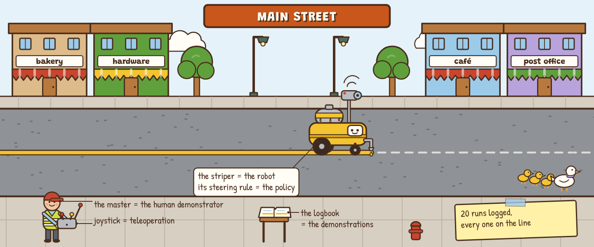
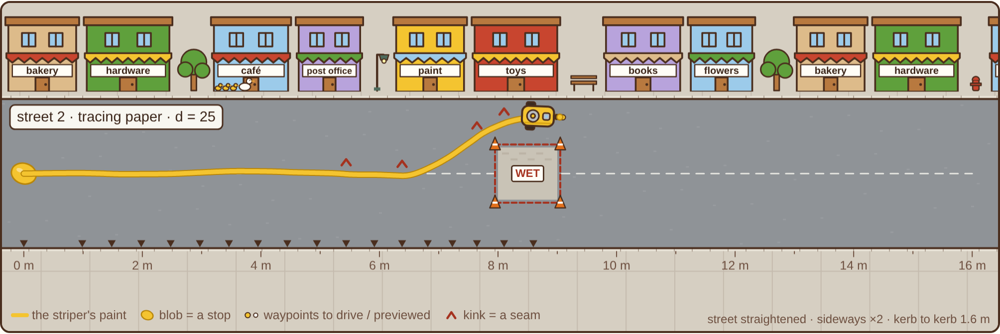

# Demos to Deployment

**A hands-on lab for how robots copy, drift, and keep moving while they think.** Teach a line-painting robot Main Street by demonstration, watch one pothole send it off the line, fix it by having the master ride along, then give it a slow brain and try every way of thinking while moving: stop and think, the committee, order ahead, switch on arrival, and tracing paper. Every mistake stays on the road.

**Play it: https://bakulbadwal.github.io/arm-playground/demos-to-deployment/**

*Step 7 in motion: same street, same 500 ms delay; switch on arrival zigzags past the wet cement, tracing paper eases round it.*

*Step 7, mid-drive: the striper takes its work orders round the wet cement on tracing paper; every blob, kink and takeover stays on the road.*

A line-marking robot learns to paint the centre line of Main Street. The **striper** is the robot and its steering rule is the policy; the **master** drives it by joystick from the kerb (teleoperation) and his twenty logged runs are the demonstrations; the **apprentice's notebook** is what the learned policy looks things up in. A **pothole** is a disturbance. A **work order** of 50 waypoints is an action chunk, the **drafting desk** is inference and its think time is the latency. A **blob** is a stop with the nozzle open, a **kink** is a seam between chunks, and the **wet cement** is a fork in the demonstrations. Hold that picture and the imitation-learning and real-time-execution chapters of Hugging Face's [*Robot Learning* tutorial](https://arxiv.org/abs/2510.12403) follow.

## What's inside

| Step | You play with | What clicks |
|---|---|---|
| **0 · Main Street** | Log the master's runs; let the apprentice paint a clean street, then one with a pothole at 4 m; see the five pages it looked up at its worst moment | Behaviour cloning copies the master perfectly where the master went. After one pothole: 3.80 m off the line, against the master's 0.00 m; at 7.9 cm off, the nearest pages it found were about 3 cm off, the edge of what the master ever did |
| **1 · Off the Map** | The notebook as a map of (offset, heading error) with the apprentice's run drawn over it; twelve streets at 4, 8, 16 and 32 m | All of the master's pages sit in 15 of 576 cells. Four times the street, 7.9× the off-line paint: compounding error, between linear and Ross & Bagnell's T²ε worst case |
| **2 · Ride Along** | DAgger, one round at a time, with β halving; the map filling in green; or instead, twenty more runs from the master | One round of the master labelling where the apprentice actually went: 0.00 m off. Forty demonstrations instead of twenty: 4.96 m off, no better |
| **3 · The Drafting Desk** | Work orders of 50 waypoints and a servo; think time d and waypoints driven per order s; a timeline of drafting and driving | Stop-and-think idles d/(d + s) of the time (28.6% at d = 10, s = 25; measured 28.9%). Driving more of each order stops less but drives on older plans |
| **4 · The Committee** | ACT's temporal ensembling: an order every tick, w_i = exp(−m·i); the votes for one tick at the cement | Smooth at d = 0, fifty orders a second. At 500 ms of think time the committee averages left and right into the cement on 21 of 40 streets |
| **5 · Order Ahead** | SmolVLA's asynchronous queue: threshold g, aggregation rule, the queue in the timeline, a sweep of g | The queue never runs dry once g ≥ d/50; at d = 10 that's 0.2, and a street takes 16.8 s instead of 23.3 s (28% faster here; SmolVLA measured ~30% on its robot, and the closeness is a coincidence of these settings). Ask too often and the striper changes its mind at the fork |
| **6 · Seams** | Naive async: switch to each order the moment it lands; ▲ marks every takeover; 40 streets at every d | Seams grow with the delay; at 500 ms 26 of 40 streets flip sides at the cement and 19 end in it |
| **7 · Tracing Paper** | Real-Time Chunking's soft mask (eq. 5) with d and s; RTC vs naive on the same streets; metres driven blind after a late pour | Freeze the waypoints that will run before the order lands, ease from the old plan into the new: 1 flip in 40 at 500 ms against 26. Not free: a little more off-line paint at short delays, and no faster reactions to a late pour (that's set by d and s) |
| **★ Review Board** | Three complaints from the town: the puddler, the zigzagger, the wanderer. Pick a fix, re-run 20 streets, name the cause | The tempting fixes (shorter orders, ask more often, average the orders, more demonstrations, a steadier master) fail for the reason the step taught |
| **✓ Field Test** | Ten questions answered by operating the widgets | Proof it stuck |

Each step has predict-then-reveal questions and a "say it out loud" line that unlocks once you've played. Every term has a tooltip with its plain meaning and its Main Street equivalent. Progress is saved in your browser.

## Why this one

The interactive robot-learning demos run one policy (LeRobot.js, in-browser ACT with MuJoCo), or explain one generative model ([Fork in the Road](https://bakulbadwal.github.io/fork-in-the-road/), Diffusion Explorer). Compounding error and DAgger live in lecture slides and racing-game videos, and the execution strategies live in papers' related-work sections. Nothing I found lets you put the same policy through every execution strategy, turn the latency up, and count the blobs, kinks and side flips. It is also a companion to the material after Unit 2 of the [Hugging Face Robotics Course](https://huggingface.co/learn/robotics-course), whose later units aren't published yet; [Arm Playground](https://bakulbadwal.github.io/arm-playground/) covers Unit 2.

## Run it

Play it live at the link above, or open `index.html` in a browser. There's no build step, no dependencies, and nothing to install. `node tests/check.js` runs the checks and prints every number in [`ACCEPTANCE.md`](ACCEPTANCE.md) (about 25 s).

## What's exact and what's a model

- **The real algorithms:** behaviour cloning as supervised learning on the demonstrator's (observation, action) pairs; DAgger's loop and its β_i = p^(i−1) mixing; synchronous execution and its idle share; naive asynchronous switching; ACT's temporal ensembling (a query every tick, w_i = exp(−m·i), w₀ the oldest, m = 0.01 from ACT's code); SmolVLA's asynchronous queue with threshold g (asked at |A|/n ≤ g, as LeRobot's code does) and three of LeRobot's four aggregation rules; Real-Time Chunking's frozen prefix, s = max(d, s_min) and soft mask. Waypoints are indexed by actions executed, as LeRobot's async client indexes actions by timestep.
- **Teaching models, labelled on the page:**
  - The street, the striper (a unicycle at 1 m/s and 50 Hz) and its servo (pure pursuit on the waypoint 12 ticks ahead), the potholes, the cement and the master (pure pursuit plus a small wobble) are hand-designed.
  - The apprentice is a 5-nearest-neighbour lookup over the logbook, behind a k-d tree: a real learner, not a neural network. Steps 0–2 copy the steering; steps 3–7 copy 50 waypoints: nozzle positions, drafted relative to where the striper was when it looked and then fixed to the street, so a servo tracks them. That mirrors chunking policies on arms, which predict joint-position targets rather than velocities.
  - RTC proper guides a flow-matching sampler. The lookup table has no sampler, so the page uses an analogue: shift each candidate chunk to continue the frozen waypoints, weight it by its agreement under the soft mask, sample one, blend it in with the mask. RTC's mask and timing; a stand-in for its guidance.
- **The directions are real; the striper isn't a real robot.** Nothing here predicts how a real ACT or SmolVLA run behaves.

Every figure quoted from a paper is in [`SOURCES.md`](SOURCES.md) with its section. Every run is seeded, so it's the same for everyone.

## Sources

- Capuano et al., [*Robot Learning: A Tutorial*](https://arxiv.org/abs/2510.12403) (2025), §4–5: the spine
- Ross, Gordon & Bagnell, [*A Reduction of Imitation Learning and Structured Prediction to No-Regret Online Learning*](https://arxiv.org/abs/1011.0686) (2011): DAgger and the T²ε bound
- Zhao et al., [*Learning Fine-Grained Bimanual Manipulation with Low-Cost Hardware*](https://arxiv.org/abs/2304.13705) (ACT, 2023): action chunking and temporal ensembling
- Black et al., [*π0*](https://arxiv.org/abs/2410.24164) (2024): H = 50, 25 actions per inference
- Shukor et al., [*SmolVLA*](https://arxiv.org/abs/2506.01844) (2025) and the [LeRobot async inference docs](https://huggingface.co/docs/lerobot/async): asynchronous inference
- Black, Galliker & Levine, [*Real-Time Execution of Action Chunking Flow Policies*](https://arxiv.org/abs/2506.07339) (2025): Real-Time Chunking

## The series

[Inference Kitchen](https://bakulbadwal.github.io/inference-kitchen/) (serving) · [Finishing School](https://bakulbadwal.github.io/finishing-school/) (post-training) · [Arm Playground](https://bakulbadwal.github.io/arm-playground/) (kinematics and control) · [Policy Pond](https://bakulbadwal.github.io/policy-pond/) (reinforcement learning) · [Fork in the Road](https://bakulbadwal.github.io/fork-in-the-road/) (diffusion policies) · [Duck's-Eye View](https://bakulbadwal.github.io/ducks-eye-view/) (robot vision) · **Demos to Deployment** (imitation learning and real-time execution) · [Inside a VLA](https://bakulbadwal.github.io/arm-playground/inside-a-vla/) (what the drafting desk is doing)

MIT licensed. Built by [Bakul Badwal](https://www.linkedin.com/in/bakulbadwal/) with Claude Code.
