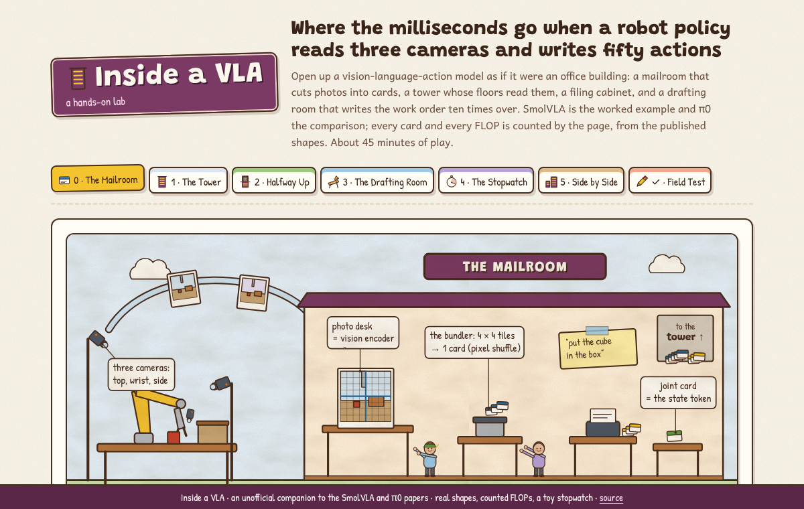
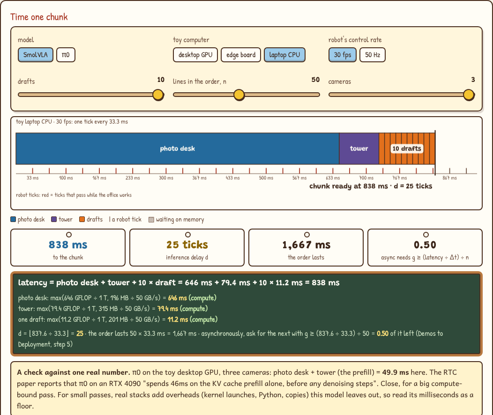
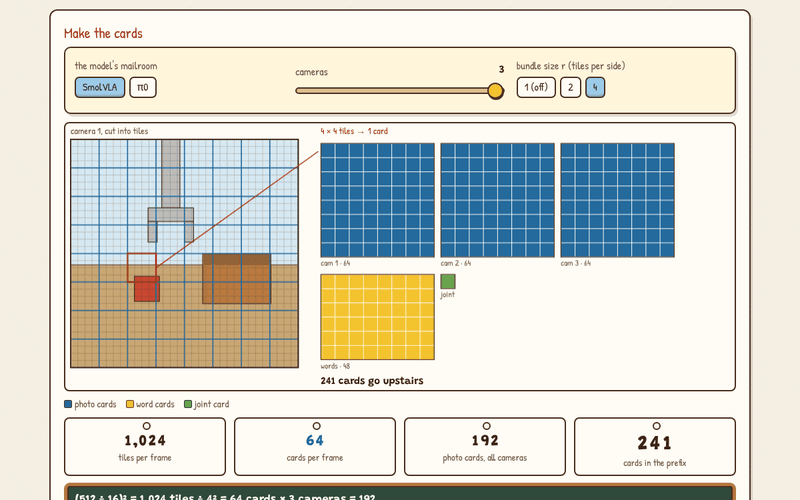

# Inside a VLA

**A hands-on lab for where the milliseconds go when a vision-language-action model turns three camera frames and an instruction into a 50-action chunk.** Open up SmolVLA like an office building: the mailroom that cuts photos into cards, the tower whose floors read them, the filing cabinet, and the drafting room that writes the work order ten times over. Count every card and every FLOP from the published shapes, put them on a stopwatch, compare with π0, then build your own.

**Play it: https://bakulbadwal.github.io/arm-playground/inside-a-vla/**

*Step 4: on a slow computer SmolVLA's chunk takes 25 robot ticks, and three quarters of that is the vision encoder.*

A VLA is an office that turns photos and a written request into a work order. Everything inside travels on **cards** (tokens). The **photo desk** is the vision encoder, which studies every 16-pixel tile; the **bundler** is pixel shuffle, which staples 4 × 4 tiles onto one card; the request is typed onto **word cards** and the arm's joint readings onto one **joint card**. The **tower** is the language-model backbone, one **floor** per layer: on every floor each card visits every desk (the **staff** are the weights) and then the **floor meeting** compares every card with every other (attention). The tower files its notes in the **filing cabinet** (the KV cache), and the **drafting room** next door (the action expert) writes the **work order** of 50 lines (the action chunk), redrafting it once per flow-matching step. The **stopwatch** is latency, measured against the robot's **tick** (the control period).

## What's inside

| Step | You play with | What clicks |
|---|---|---|
| **0 · The Mailroom** | The model's mailroom (SmolVLA or π0), cameras, bundle size r; a frame cut into tiles and the prefix of cards it becomes | (512 ÷ 16)² = 1,024 tiles ÷ 4² = 64 cards a frame. SmolVLA's tower reads 3 × 64 + 48 + 1 = 241 cards; π0's, from smaller frames with no bundling, 816 |
| **1 · The Tower** | The prefix bill (photo desk, projector, tower staff, tower meetings) and the tower's cost curve against the number of cards | A pass costs 2 × weights × tokens plus 4 × width × tokens² per layer. At 241 cards attention is 4.5% of SmolVLA's tower; turn the bundler off and the tower costs 19.9× more. With it on, 89% of the prefix is the photo desk |
| **2 · Halfway Up** | Floors kept, N = 4…32, with SmolVLA's Table 8 success rates on the same chart | Keeping 16 of 32 floors exactly halves the tower and the drafting room but saves only 19% of the chunk, because the photo desk doesn't move. LIBERO: 80.3 → 78.5 |
| **3 · The Drafting Room** | Who each action token reads on SmolVLA's cross and self floors and on π0's; drafts, chunk size, the KV cache on or off | One draft is 14% of the tower's pass. Without the cache, π0 pays 7.9× and SmolVLA 1.9×: the bigger the tower, the more the cache is worth |
| **4 · The Stopwatch** | Three toy computers, two control rates, drafts, chunk size, cameras; a timeline against the robot's ticks | Each stage is the slower of its arithmetic and its weight reads. Drafts over 50 tokens are memory-bound, so 10 lines cost what 50 cost. SmolVLA: 11.1 ms on the toy GPU, 838 ms (d = 25 at 30 fps) on the toy laptop. On π0 the toy GPU gives a 49.9 ms prefill against the reported 46 ms. Async needs g ≥ (latency ÷ Δt) ÷ n, and when that passes 1 no threshold works |
| **5 · Side by Side** | SmolVLA and π0 in the papers' words and this lab's count; a builder with every lever and three work orders | π0 has 7× the parameters and spends 5.2× the FLOPs per chunk. Halving SmolVLA's latency on the edge board takes the photo desk: fewer floors and drafts can't do it |
| **✓ Field Test** | Eight questions answered by operating the widgets | Proof it stuck |

Each step has predict-then-reveal questions and a "say it out loud" line that unlocks once you've played. Every term has a tooltip with its plain meaning and its office equivalent. Progress is saved in your browser.

## Why this one

VLAs are explained in architecture diagrams, and their costs in a paper's single latency number. Nothing I found lets you change one design choice (tokens per frame, layers kept, expert width, denoising steps, cameras) and watch the token count, the FLOPs and the latency move together, part by part. It sits between two siblings: [Fork in the Road](https://bakulbadwal.github.io/fork-in-the-road/) teaches the flow-matching steps the drafting room runs (this lab only counts them), and [Demos to Deployment](https://bakulbadwal.github.io/arm-playground/demos-to-deployment/) teaches what to do with the inference delay d this lab produces. [Inference Kitchen](https://bakulbadwal.github.io/inference-kitchen/) covers KV caching and serving in general.

## Run it

Play it live at the link above, or open `index.html` in a browser. There's no build step, no dependencies, and nothing to install. `node tests/check.js` runs the checks and prints every number in [`ACCEPTANCE.md`](ACCEPTANCE.md) (under a second).

## What's exact and what's a model

- **Exact, from the papers, configs and code:** the token counts (SmolVLA: 64 per 512-pixel frame after pixel shuffle with r = 4, plus one state token; π0: 256 per 224-pixel frame; 48 instruction tokens, which LeRobot's π0 always pads to and the released `smolvla_base` config pads to as well); the shapes (SmolVLM2-500M's SigLIP-B/16 and 32-layer, 960-wide decoder, of which SmolVLA keeps 16; an expert 0.75× as wide, one layer per VLM layer kept, cross-attention and causal self-attention alternating as LeRobot runs them; PaliGemma's SigLIP-So400m/14 and Gemma-2B; π0's 1024-wide expert); n = 50 and 10 flow-matching steps for both; the order of work (encode, prefill once and cache, then one expert pass per step). Weight counts follow from the shapes: 98M for SmolVLA's expert and 311M for π0's, against the papers' "~100M" and "~300M"; SigLIP-B/16 is 93M in the SmolVLM paper and 86M here, because the count has only the matrix weights, not the pooling head, biases and norms.
- **Teaching models, labelled on the page:**
  - FLOPs are 2 per weight per token plus 4 × (query width) × (queries) × (keys) per attention layer. A cross-attention layer's k and v projections are counted over the 241 cached prefix tokens on every step, as LeRobot runs them (a tuned stack could do that once per chunk). π0's state token is counted once and cached, as the paper says it can be; LeRobot's code re-embeds it with the actions on every step, one token in 51. Norms, biases, softmax, the small state, action and time projections, and the embedding lookup are left out, and the backbone's prefix is counted with full attention.
  - Milliseconds come from made-up computers: a toy desktop GPU (80 TFLOP/s, 1 TB/s), a toy edge board (10 TFLOP/s, 100 GB/s) and a toy laptop CPU (1 TFLOP/s, 50 GB/s). Each stage takes max(FLOPs ÷ F, weight bytes ÷ B), with weights in bf16. On π0 the toy GPU's prefill comes out at 49.9 ms against the 46 ms reported on an RTX 4090: close for a big compute-bound pass. For small passes real stacks add kernel-launch and Python overheads this model leaves out, so its milliseconds are a floor, not a forecast.
- **The office is an analogy.** Weights aren't people and attention isn't a meeting; the counts are the real counts. Nothing here measures a real robot or a real GPU.

Every figure quoted from a paper is in [`SOURCES.md`](SOURCES.md) with its section. π0's Table I timing breakdown could not be checked from the paper text, so it isn't quoted.

## Sources

- Shukor et al., [*SmolVLA*](https://arxiv.org/abs/2506.01844) (2025): the worked example
- Black et al., [*π0*](https://arxiv.org/abs/2410.24164) (2024): the comparison
- Marafioti et al., [*SmolVLM*](https://arxiv.org/abs/2504.05299) (2025): pixel shuffle, SigLIP-B/16
- Beyer et al., [*PaliGemma*](https://arxiv.org/abs/2407.07726) (2024): 224 px → 256 tokens
- Black, Galliker & Levine, [*Real-Time Execution of Action Chunking Flow Policies*](https://arxiv.org/abs/2506.07339) (2025): π0's 46 ms prefill, d = ⌊δ/Δt⌋
- [LeRobot](https://github.com/huggingface/lerobot)'s SmolVLA and π0 code and the released configs on the Hugging Face Hub

## The series

[Inference Kitchen](https://bakulbadwal.github.io/inference-kitchen/) (serving) · [Finishing School](https://bakulbadwal.github.io/finishing-school/) (post-training) · [Arm Playground](https://bakulbadwal.github.io/arm-playground/) (kinematics and control) · [Policy Pond](https://bakulbadwal.github.io/policy-pond/) (reinforcement learning) · [Reward Arcade](https://bakulbadwal.github.io/reward-arcade/) (environments and evals) · [Fork in the Road](https://bakulbadwal.github.io/fork-in-the-road/) (diffusion policies) · [Duck's-Eye View](https://bakulbadwal.github.io/ducks-eye-view/) (robot vision) · [Demos to Deployment](https://bakulbadwal.github.io/arm-playground/demos-to-deployment/) (imitation learning and real-time execution) · [Eye Exam](https://bakulbadwal.github.io/ducks-eye-view/eye-exam/) (camera calibration) · [Dual Controls](https://bakulbadwal.github.io/policy-pond/dual-controls/) (real-world RL with a human in the loop) · **Inside a VLA** (VLA anatomy and compute)

MIT licensed. Built by [Bakul Badwal](https://www.linkedin.com/in/bakulbadwal/) with Claude Code.
